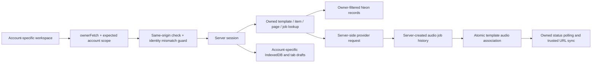

# GenZee user ownership — implementation aur handover

Date: 10 October 2026

## Scope

Yeh implementation frontend repository ke UI aur Next.js server routes mein hai.
Initial frontend ownership phase mein FastAPI repository change nahin hui thi.
11 October ko alag gateway app authorization aur Facebook isolation implement hui;
is ki details `D:\AIModels_SearchAPIS\APP_ACCESS.md` mein hain. Pehle se maujood Audio Library
aur workspace navigation changes preserve kiye gaye hain.

Is repository mein private resources ka owner authenticated server session se
nikalta hai. Request body ka user_id, email, job metadata ya audio URL ownership
ka proof nahin hai. Doosre account ke resource ID par private data ya external
provider action execute nahin hota.

## Request aur data flow

| Layer / file | Zimmedari |
| --- | --- |
| proxy.ts | API mutations ka Origin check, private responses par no-store, stale account requests par 409 |
| app/lib/auth/ownership.ts | Authenticated user, DB availability, owned template, content item aur connected page checks |
| app/lib/ownerStorage.ts | Account scope bootstrap, ownerFetch, account aur tab-specific drafts |
| app/components/IdentityBoundary.tsx | Workspace aur sidebar ko identity verify hone tak protect karna; account switch par reload |
| app/lib/localIndexedDB.ts | Har account/guest ke liye alag history aur presets database |
| app/lib/auth/guestOwner.ts | HttpOnly guest identity aur owner/job-specific signed polling proof |
| app/lib/audioJobs.ts | Owned job lookup, provider status identity check aur server-authoritative URL update |
| app/lib/audioJobLinks.ts | Parallel generations ko preserve karne wala atomic template update |
| app/lib/deleteOwnedAudio.ts | Owned history aur template audio links ki consistent removal |
| app/lib/ownedMedia.ts | Owned template/item se scoped media list aur trusted file selection |
| app/lib/privateDownload.ts | HTTPS storage allowlist, no redirects aur private download response |

## Resource-wise behavior

### Voice generation aur audio jobs

1. Online mode mein generation se pehle session, credits aur quota check hote hain.
2. Template/item context ho to dono ki ownership provider call se pehle check hoti hai.
3. Provider ke naye job ID ko generation_history mein session user ke saath save
   kiya jata hai. Browser ab job ownership create nahin karta.
4. Template association server ke model, voice, time aur audio metadata se banti hai.
5. Polling pehle owner lookup karti hai, phir provider ko call karti hai. Provider
   response ka job_id requested ID se match hona zaroori hai.
6. Completed audio URL history aur pehle se linked owned templates mein server
   update karta hai. Browser ka supplied audioUrl authoritative nahin hai.
7. Synchronous audio ka returned ID history record ke ID se match karta hai.
   Persistence fail ho to success response nahin diya jata.
8. Generation unmount par request abort hoti hai. Late result save/display karne
   se pehle original account scope dobara verify hota hai.

### Guest aur offline mode

- Guest generation sirf explicitly disabled database mode mein chalti hai.
- Guest identity HttpOnly cookie mein hoti hai; active usage par expiry renew hoti hai.
- Polling ke liye cookie ke saath signed token chahiye. Token exact guest, job aur
  expiry se bound hai; uski lifetime 7 din hai.
- Production mein OWNERSHIP_TOKEN_SECRET ya GOOGLE_CLIENT_SECRET zaroori hai.
  Dedicated, stable OWNERSHIP_TOKEN_SECRET recommended hai. Isay browser/public
  environment variable mein expose na karein. Development-only fallback process
  restart par purane guest polling tokens invalidate karta hai.
- Local DB name VoiceGeneratorDB:<owner_scope> hai. Presets aur history dono is
  namespace ko use karte hain.
- Drafts genzee:<owner_scope>:<key> ke saath sessionStorage mein hain, is liye
  accounts aur tabs ek doosre ka pending script consume nahin karte.
- Cookies clear/expire hone par guest ka purana namespace khud recover nahin hota.
  Authenticated account ka namespace login sessions ke darmiyan stable rehta hai.

### Account switch aur logout

- UI requests X-Owner-Scope bhejti hain. Proxy isay actual session/guest identity
  se compare karti hai; mismatch par route tak request nahin jati.
- Logout par doosre tabs ko BroadcastChannel notification milti hai.
- Workspace initial load, focus aur identity notification par verify hota hai;
  periodic check bhi 15 seconds par hoti hai.
- Same-account focus ke waqt editor aur requests preserve rehte hain. Identity
  badle to workspace reload hota hai, jis se sidebar aur previous in-memory data
  clear ho jata hai.
- Identity verification fail ho to private workspace unmount/hide hota hai.

### Facebook aur Instagram

- Shared local_user fallback remove ho gaya hai. Private page/post operations ko
  authenticated account aur database chahiye.
- Publish/schedule se pehle selected active page ka owner check hota hai.
- Supplied template/item association bhi current account ki honi chahiye.
- Connect ke waqt page token ka actual identity /me se verify hota hai.
  Doosre page ka token reject hota hai. Token URL query mein bhejne ke bajaye
  Authorization header mein bheja jata hai.
- Gateway token save fail ho to connected-success response aur active local
  metadata write nahin hoti.
- Existing cancel/reschedule routes ab bhi local scheduled_posts update karti
  hain. Facebook par actual cancellation/rescheduling purana separate functional
  gap hai; ownership implementation isay provider-side success claim nahin banati.

### Media

- Process, poll, download aur delete ko owned template aur uska actual item chahiye.
- Backend user_id hamesha session se aata hai.
- Download/delete ke selected URLs scoped backend media list se verify hote hain.
- Signed query parameters rotate hone par trusted server list ka fresh URL use
  hota hai; caller query parameters fetch nahin hote.
- Backblaze B2 HTTPS hosts allow hain. Kisi aur storage host ke liye
  MEDIA_DOWNLOAD_HOSTS mein exact comma-separated hostnames configure karein.
  Download redirects follow nahin hote.
- Arbitrary URL wala anonymous download proxy remove/replace ho gaya hai.

### History, templates, presets, settings aur billing

- Existing owner-filtered records preserve hain. Template confirmation email
  authenticated account se stamp hoti hai.
- Audio Library delete ab owned template audio entries aur history dono unlink
  karta hai. Foreign/missing audio par 404 milta hai.
- Browser-written unused history POST retire ho gaya hai; history creation ab
  generation server route ki zimmedari hai.
- Unverified payment webhook ab 503 deta hai aur credits nahin allocate karta.
  Public payments pehle se disabled the.
- Development sandbox ke liye NODE_ENV=development aur
  ENABLE_PAYMENT_SANDBOX=true dono chahiye. Untrusted Host header se production
  credit simulation unlock nahin hoti.
- Offline billing status ab bina actual authenticated ledger record ke paid-success
  fabricate nahin karta.
- OAuth callback ko matching state aur nonce cookie chahiye; missing/legacy
  state reject hoti hai. Return destination same-origin hota hai aur Google email
  verification required hai.

## Removal se pehle re-check

Imports, component names, exported helpers, URL callers aur storage-key readers ko
app, components, lib, scripts, public aur e2e mein rg --no-ignore se dobara check
kiya gaya. Definitions/self references aur documentation mentions ko active caller
nahin maana gaya. Related code replace karne ke baad stale references dobara search
kiye gaye. Typecheck aur production route generation ne bhi remaining callers check kiye.

| Removed / reduced code | Re-check ka nateeja |
| --- | --- |
| app/components/ApiToggle.tsx | Koi rendered component/import nahin; sirf apna old config route caller |
| app/api/voiceover/config/route.ts | Sirf unused ApiToggle use karta tha; shared runtime provider toggle |
| app/components/FacebookPostForm.tsx | Koi rendered/imported caller nahin; direct gateway legacy form |
| app/lib/usageLimit.ts | Sirf self references; stale shared localStorage quota implementation |
| app/lib/replicateService.ts | Exported generation/voice helpers ka active caller nahin |
| app/lib/voiceoverApi.ts helpers | Active generation/polling helpers use nahin hote the; VoiceSample type ke 3 callers preserve hain |
| app/api/voiceover/[id]/route.ts | Unused legacy helpers ke callers; fake completed/delete responses |
| app/api/voiceover/[id]/download/route.ts | Legacy helper caller; 501 stub |
| app/api/voiceover/proxy-audio/route.ts | Koi active caller nahin; anonymous shared cached audio proxy |
| history POST | Koi active client caller nahin; current generation route history create karti hai |
| pending_facebook_post write | Sirf writer tha, koi reader nahin |
| Browser audio-job POST/PUT in useVoiceGenerator | Server-side generation registration/link/sync se replace |
| Duplicate missing-user branch in generation | requireUser pehle hi missing online user reject karta hai |

Unused file removal Git diff mein reviewable hai; commit/deploy nahin kiya gaya.

## Purane data ki compatibility

- Purana unscoped VoiceGeneratorDB delete nahin kiya gaya. Us data ka owner prove
  nahin hota, is liye kisi naye account ko automatically import nahin kiya gaya.
- Purane raw pending_voice_* aur Facebook prefill keys naye flows read nahin karte.
- Purane template audio URLs abhi play ho sakte hain jab tak valid hain. Jis
  legacy job ka trusted generation_history mapping nahin tha, usay polling se
  automatically claim nahin kiya ja sakta. Renewal ke liye dobara generation ya
  gateway-side verified ownership migration chahiye.
- Existing schema reuse hui hai; koi destructive database migration nahin hai.

## Verification

| Check | Result |
| --- | --- |
| npm run test:ownership | 35 tests pass; mocked DB/providers, live account changes nahin |
| npx tsc --noEmit --incremental false | Pass |
| Production Next.js build | Pass; final source changes ke baad bhi verify |
| Core ownership helpers/routes/hooks ka targeted ESLint | Pass |
| Browser QA | 8 checks pass: workspace load, request scope, same-owner focus, account switch, namespaced drafts, session failure, mobile fit, zero page errors |
| Whole repository lint | Purane lint issues baqi: 192 errors / 107 warnings; initial baseline 216 / 122 |
| git diff --check | Pass |

Browser fixtures mein models/voices aur account profiles mocked the. Live Google,
Meta, payment, provider generation aur Neon integration ko is verification mein
call nahin kiya gaya. SQL ownership/filter behavior mocked tag queries se verify
hua; live PostgreSQL concurrency test nahin hua.

Browser evidence:
- output/playwright/ownership-desktop.png
- output/playwright/ownership-mobile.png

## Gateway aur future work ki boundary

Frontend route ownership direct FastAPI requests ko protect nahin kar sakti.
Gateway ab registered app origin, app-bound key, FastAPI owner permission aur exact
endpoint permission lazmi verify karta hai. Facebook tokens app-wise isolate hain.
Next.js gateway calls server-only `GATEWAY_API_KEY` aur `GATEWAY_APP_ORIGIN` settings
se credentials bhejti hain. FastAPI owners sirf gateway ki `users` table se hain;
frontend user IDs ko un se map nahin kiya jata. Frontend audio job aur item ownership
checks apni session/user table ke mutabiq hi rehte hain. Backend par authorized apps
ke darmiyan audio job aur extracted-media resource isolation alag future work hai.

Payment enable karne se pehle verified provider callback, persisted server-created
order owner, exact amount/currency validation aur transactional replay protection
chahiye. Webhook ko sirf success payload/user_id se kabhi enable na karein.

Signed storage URLs possession-based access deti hain jab tak expire na hon.
Already copied URLs ko logout par revoke karna is frontend layer se possible nahin.
Us requirement ke liye gateway/storage level short-lived delivery ya authenticated
streaming chahiye.

Credits/quota charging aur external provider creation ko single cross-system
transaction banana is change ka scope nahin tha. DB failure par provider mein
orphaned job ho sakta hai; frontend ownership mapping fail ho to successful ownership
response nahin di jati. Reconciliation/refund flow separate backend work hai.

## TTS selective retry UI (13 October 2026)

Studio aur landing demo ab completed/total audio parts dikhate hain. Retry route online mode mein owned `generation_history` lookup aur offline mode mein exact guest/job signed token verify karti hai; is ke baad server-only app credentials se gateway retry hoti hai. Initial generation/credit/quota code dobara nahin chalta. Editor badalne par bhi pending job ke original parameters local history mein use hote hain. Progress ke liye existing owned status route reuse hoti hai. Pending context mounted studio tak mehdood hai; reload aur Audio Library/content-detail recovery alag scope hai.

## Ordered live preview (13 October 2026)

`/api/templates/audio-job/stream` pe wohi owned-history ya cookie-bound guest proof check hota hai. Server-only app credentials gateway ko jate hain. `LiveAudioPreview` contiguous chunk indexes receive karta hai; retry pe next received index se reconnect hota hai. **Listen live** click karne ke baad ready parts sequence mein play hote hain. Preview fail hone par final polling/audio available rehte hain, aur koi dobara generation/credit charge nahin hota. Played/unmounted Blob URLs release hote hain. Mounted context aur hosting ke 300-second stream limit ki boundary abhi rehti hai.

Verification: 45 mocked ownership tests, TypeScript, targeted ESLint, production build aur desktop/mobile Edge playback checks pass. Fixtures mein ek generation, ek retry, stream cursors `[0,1]`, ordered parts 1-3 aur zero page errors verify hue. Hosted streaming buffering aur real provider/B2 audio is verification ka hissa nahin the.

## Refresh, Library aur detail recovery (13 October 2026)

Pending context ab owner-namespaced local storage mein save hota hai. Session verify hone ke baad studio original job restore karke sirf progress check karta hai; failed/quota job automatic retry nahin hoti. Audio Library browser ke pending records aur owner-filtered, server-created unfinished history dikhati hai. **Resume in Studio** usi job ko select karta hai. Shared `AudioPlayer` missing audio par `AudioJobRecovery` ke existing owned status/retry flows use karta hai; generation aur charging dobara nahin hoti.

Stream unexpected close hone par next received index se reconnect hoti hai. Consecutive failure attempts 3 hain (1/2/4 second waits); explicit completed/failed events ya ownership denial par reconnect rukti hai. Browser storage authority nahin hai: server ke history lookup ya cookie-bound guest proof ke baghair access nahin milta. Completed/inaccessible records sirf current account se clear hote hain. Private-mode storage unavailable ho to current generation ka flow chal sakta hai, magar offline refresh recovery guarantee nahin hoti.

Latest manual verification guide backend mein `TTS_TESTING.md` hai. Frontend fixtures ne Library-to-Studio resume, refresh, reconnect, ordered playback aur content-detail retry check kiya; live provider/B2 verification user testing mein baqi hai.

Latest verification: 48 mocked frontend ownership tests, changed-flow ESLint/TypeScript aur final production build pass. Browser storage clear hone ke baad owned server history se bhi recovery verify hui; pending context helper completed/untrusted history ko reject karta hai. Edge desktop/mobile checks mein initial generation sirf ek thi; resume/retry ne dobara charging flow nahin chalaya. Backend ke 115 isolated regressions pass hain. Is phase mein nayi DB migration nahin hai.

## Library aur focus correction (2026-10-14)

Audio Library pehle sirf template-linked audio parhti thi; ab current-user Studio history bhi include hoti hai. Dono SQL sources aur single play/download lookup owner-filtered hain; job ID se duplicate rows hat-ti hain. Configured frontend DB ke read-only check mein screenshot account ki 28 completed Studio voices list mein aayin; single URL lookup pass raha, koi data mutation nahin hui.

Unfinished cards load, focus aur har 15 seconds par owned status reconcile karti hain. Completed job server history mein sync hoti hai, card remove hota hai aur Library table refresh hoti hai. Offline mode current-owner IndexedDB parhta hai; completed async jobs stable job ID se save hoti hain. Same-account focus ab workspace ko invisible nahin karta; identity-change notifications loading/reload isolation retain karti hain. Internal `server_owned_job` badge bhi hide hai.

117 isolated backend aur 50 mocked frontend tests pass. Online/offline Edge fixtures ne completed rows, stale pending removal, automatic table refresh, visible focus, offline recovery/history aur account isolation verify ki; page errors aur new generation requests zero thay. Live Gemini performance/B2 transfer aur hosted deployment is check ka hissa nahin thay.

## Audio Library removal (2026-10-14)

Trash button existing confirmation dialog aur owner-filtered delete route use karta hai. Request ke darmiyan confirmation/cancel disabled hain; failure par readable error ke saath row aur dialog rehte hain. Successful removal owned history/template links, matching pending record aur stable-ID offline copy ko clear karta hai; playback stop hoti hai aur list/page backfill hoti hai. Last page khali ho to previous valid page select hota hai. Offline transaction commit hone se pehle success nahin dikhayi jati. Yeh Library/history removal hai; gateway job aur B2 object physical deletion is flow mein nahin hoti.

54 isolated ownership/local-storage tests aur production frontend build pass. Mocked Edge UI checks: cancel, failure/retry, repeated-confirmation prevention, playback stop, offline-copy removal, reload persistence aur last-page/backfill pass; page errors zero. Asli user audio test mein delete nahin ki gayi.

## JSONB delete error aur repeated missing jobs (2026-10-14)

Legacy `audio_urls` object/null/scalar par unguarded `jsonb_array_elements` se PostgreSQL 22023 aa raha tha. Delete, link aur completion-sync SQL mein CASE guards add hain; delete unknown non-array metadata ko preserve karta hai. Library-owned standalone history delete ab unrelated legacy object ki wajah se fail nahin hoti. Populated unsupported objects ko linking overwrite nahin karti.

Verified current-user gateway 404 par history mein `gateway_job_missing` flag lagta hai; pending query aur restore helper us ko dobara automatic poll mein nahin laate. History delete nahin hoti. Temporary 5xx/network failure par flag nahin lagta; later successful explicit status check flag clear kar sakti hai. Yeh flag user-facing voice badges mein show nahin hota.

`npm run test:audio-json` configured PostgreSQL par sirf transaction-local temporary tables use karta hai, search_path pg_temp aur ON COMMIT DROP ke saath. Actual SQL checks passed: standalone deletion, mixed JSON types, linked deletion/clear-all, other-owner preservation, empty-object linking, completion sync aur missing-pending exclusion. Permanent user records change nahin hue. 57 ownership regressions bhi pass hain. Nayi migration nahin chahiye.

## Checkbox aur selected deletion (2026-10-14)

Har audio row par labelled checkbox hai. Header checkbox current page select/deselect karta hai; partial selection par indeterminate state hai. Selection pages ke darmiyan retain hoti hai, search/model filter change par clear hoti hai. Delete selected confirmation count dikhata hai aur existing owner-scoped batch route ko ek request bhejta hai. Offline batch ek IndexedDB transaction mein commit hoti hai; normal single deletion bhi available hai.

59 ownership/local-storage tests, actual PostgreSQL temporary-table batch isolation, changed-file ESLint aur production build pass. Edge checks mein row/page/cross-page selection, partial header, cancel, single batch request, reload persistence, filter reset aur existing single-delete flow pass; page errors zero. Asli user voices delete nahin ki gayin.

## Duration aur size restore (2026-10-14)

Library union query se duration/size omit ho rahe thay; table missing values par columns hide kar rahi thi. Ab columns hamesha visible hain, unknown values '-' hain aur returned numeric strings normalize hoti hain. Duration existing history column aur size existing parameters JSONB mein save hoti hai; async completion linked template metadata bhi sync karti hai. Backend status mein size_bytes expose hai. Synchronous PCM WAV header se server-measured duration milti hai; historical inline aur offline WAVs ke bounded headers fallback dete hain. Library response mein audio headers/base64 transfer nahin hota. Nayi migration nahin hai.

Screenshot account ke do completed remote WAV records ki missing statistics approved private-storage header ranges se recover karke sirf owner-filtered history fields mein save ki gayin. Dono records duration/size ke saath read-only Library query mein verified hain; audio regenerate/delete aur credits/auth change nahin hue.

64 frontend ownership/metadata tests, 31 isolated backend audio/chunk/stream tests, actual PostgreSQL temporary-table persistence/query checks, targeted lint/typecheck aur production build pass. Edge fixture ne duration/size headers, formatted values aur existing checkbox/delete behavior verify kiya; page errors zero. Unsupported formats ya header mein unusually large metadata chunk ho to duration unknown reh sakti hai.

## Shared shell coverage audit (2026-10-14)

Source aur mocked Edge browser audit ne tamam 15 workspace routes verify kiye: admin, audio-library, billing, settings, templates, json-generator, content/list/detail, YouTube templates/content/detail aur Facebook templates/content/detail/integration. Har route par ek Sidebar aur ek shared Header element hai. Header existing design ke mutabiq desktop par CSS-hidden aur mobile par visible hai; open/close toggle har route par pass hua. Legacy facebook-integration redirect covered route par pahunchta hai; page errors zero. Per-page imports ki zaroorat nahin aur koi missing workspace shell nahin mila. Public Home/Pricing/Blog/About/FAQ/contact/legal pages apna marketing navbar retain karti hain; landing/showcase Home par redirect hote hain.
